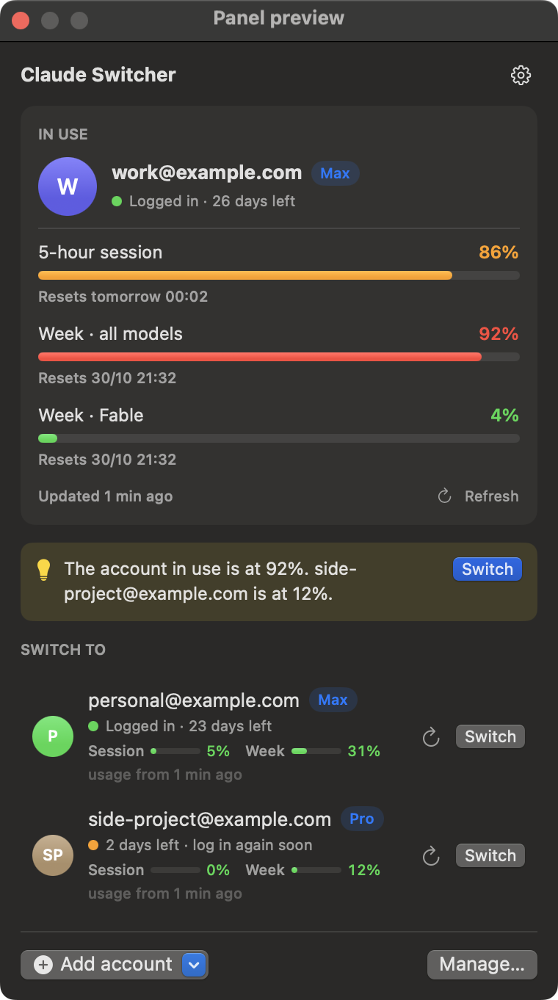
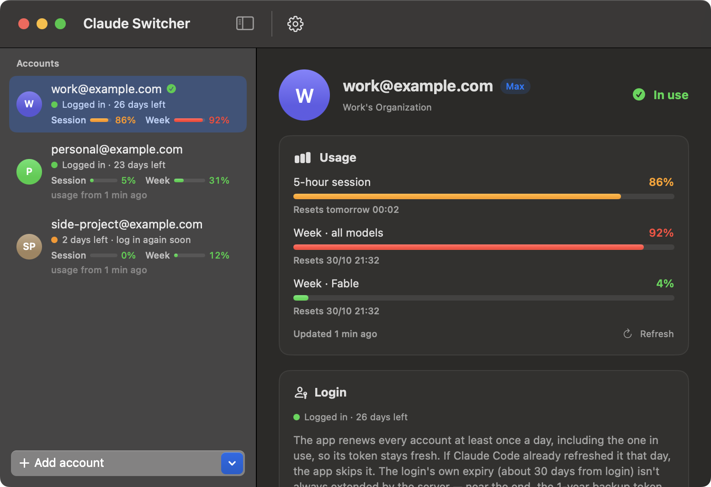

# Claude Account Switcher

**App trên thanh menu macOS để chuyển qua lại giữa nhiều tài khoản Claude Code.** App hiện hạn mức (usage) của từng tài khoản và tự gia hạn mọi login mỗi ngày.

[English](README.md)

<p align="center">
  
  &nbsp;
  
</p>

## Vì sao cần

Claude Code chỉ giữ một login trên mỗi máy Mac. Nếu bạn có nhiều gói Claude, ví dụ một tài khoản công ty và một tài khoản cá nhân, thì đổi tài khoản vướng 3 việc:

- Lần nào cũng phải chạy `/login` và đăng nhập lại trên trình duyệt.
- Không biết tài khoản nào còn hạn mức phiên 5 giờ và hạn mức tuần.
- Tài khoản lâu không dùng có thể bị đăng xuất đúng lúc cần.

App giữ mọi tài khoản bạn đã đăng nhập và chuyển giữa chúng bằng một cú bấm. App hiện usage của từng tài khoản và tự gia hạn ở nền.

## Tính năng

- **Chuyển tài khoản bằng một cú bấm** trên thanh menu. Settings, plugin, MCP và memory trong `~/.claude` vẫn dùng chung cho mọi tài khoản.
- **Usage của mọi tài khoản:** phiên 5 giờ, hạn mức tuần và hạn mức tuần theo từng model, kèm giờ reset. App đọc bằng `/usage` của chính Claude Code, không tốn lượt chat.
- **Gợi ý chuyển tài khoản:** khi tài khoản đang dùng vượt 80%, app gợi ý tài khoản còn nhiều hạn mức nhất.
- **Tự gia hạn hằng ngày:** mọi tài khoản đã đăng nhập, kể cả tài khoản đang dùng, được gia hạn ít nhất 1 lần mỗi ngày để token luôn mới.
- **Không làm gián đoạn agent đang chạy:** đọc usage và gia hạn tài khoản không dùng đều chạy trong hồ sơ riêng. App không bao giờ tự đổi login đang dùng.
- **Token dự phòng 1 năm:** lưu một `claude setup-token` cho mỗi tài khoản. Khi login thường hết hạn, app tự chuyển Claude Code sang token này.
- **Thêm tài khoản bằng cửa sổ ẩn danh:** đăng nhập tài khoản thứ hai trong cửa sổ ẩn danh của Brave, Chrome, Edge, Vivaldi, Opera hoặc Firefox, mà không đăng xuất claude.ai trên trình duyệt chính. Không cần Terminal.
- **Bảo vệ khỏi phiên cũ:** nếu một phiên còn đang chạy ghi đè token của tài khoản cũ, app lưu token đó cho đúng tài khoản rồi đặt lại tài khoản bạn đã chọn.
- **Nhẹ:** khoảng 0,1% CPU khi rảnh. Mọi việc với Keychain và file chạy ngoài luồng giao diện.
- **Giao diện tiếng Việt và tiếng Anh**, đổi ngay trong app.

## Cách hoạt động

| Phần | App làm gì |
|---|---|
| **Chuyển tài khoản** | Claude Code lưu login ở mục Keychain `Claude Code-credentials` và lưu tài khoản ở `~/.claude.json` → `oauthAccount`. App giữ bản sao của từng tài khoản trong mục Keychain riêng (`ClaudeSwitcher`, `<accountUuid>.login` / `.setup`) và ghi tài khoản được chọn vào cả hai chỗ. |
| **Hồ sơ riêng** | Tài khoản không dùng chạy với `CLAUDE_CONFIG_DIR=~/Library/Application Support/ClaudeSwitcher/profiles/<id>`. Khi đó Claude Code dùng mục Keychain `Claude Code-credentials-<8 ký tự hex đầu của sha256(đường dẫn)>`, nên login đang dùng không bị đụng tới. Token mới được lưu ngược lại. App không bao giờ chạy hồ sơ riêng cho tài khoản đang dùng login thường, vì như vậy sẽ đổi refresh token mà các phiên đang mở đang giữ. |
| **Tự gia hạn** | Mỗi 24 giờ, khi access token (khoảng 8 giờ) đã hết hạn, app chạy `/usage` (miễn phí) để Claude Code làm mới token. Chỉ khi token vẫn chưa đổi mới gửi 1 câu rất nhỏ bằng `haiku`. Lần nào Claude Code đã tự làm mới trong ngày thì được tính. |
| **Token dự phòng** | Token `claude setup-token` (khoảng 1 năm) được ghi vào `~/.claude/settings.json` → `env.CLAUDE_CODE_OAUTH_TOKEN` chỉ khi login thường không dùng được, và được gỡ ra khi login dùng được lại. Token này có thể không hỗ trợ vài tính năng gắn với claude.ai, và không đọc được usage của gói. |
| **Usage** | `claude -p /usage --no-session-persistence` cho từng tài khoản. Tài khoản đang dùng được đọc khi mở panel (nếu số liệu cũ hơn 60 giây), và khi chạy ngầm thì 15 phút một lần ở mức ưu tiên thấp, vì mỗi lần tốn khoảng 6 giây CPU. |
| **Đồng bộ** | Mỗi 3 giây khi panel hoặc cửa sổ đang mở hay đang chờ đăng nhập, và 15 giây khi chạy ngầm. App lưu token Claude Code đã đổi và tự nhận tài khoản mới đăng nhập. |
| **Đăng nhập** | App chạy `claude auth login` ở nền, với `$BROWSER` trỏ tới một script nhỏ chỉ ghi lại link đăng nhập. Link được mở ở nơi bạn chọn, và Claude Code tự nhận kết quả qua `localhost`. Nếu trang chỉ hiện một mã, dán mã vào ô **Dán mã** trong app. |

## Yêu cầu

- macOS 15 Sequoia trở lên
- Xcode 16+ / Swift 6, để build từ mã nguồn
- Đã cài [Claude Code](https://docs.anthropic.com/en/docs/claude-code) (`~/.local/bin/claude`, Homebrew hoặc `/usr/local/bin`)

## Cài đặt

```sh
git clone https://github.com/ChisThanh/claude-account-switcher.git
cd claude-account-switcher
./scripts/build-app.sh --install    # build, copy vào ~/Applications rồi mở
```

App được ký ad-hoc, không cần Apple Developer ID. App chạy trên thanh menu (✦ kèm tên tài khoản). Mở lại app từ Finder hoặc Spotlight thì cửa sổ quản lý hiện lên.

## Bắt đầu

1. **Thêm tài khoản.** Bấm **Thêm tài khoản** và chọn **Cửa sổ ẩn danh** để đăng nhập một tài khoản khác với tài khoản đang mở trên trình duyệt chính. App nhận tài khoản sau vài giây. Lặp lại cho từng tài khoản.
2. **Chuyển tài khoản.** Mở menu ✦ và bấm **Chuyển** cạnh tài khoản muốn dùng. Phiên `claude` mới dùng ngay tài khoản đó. Phiên đang mở từ trước vẫn giữ tài khoản cũ cho tới khi bạn mở lại (`/exit` rồi `claude`), và app cho biết còn bao nhiêu phiên như vậy.
3. **Thêm token dự phòng (nên làm).** Bấm **Quản lý… → Token dự phòng 1 năm → Mở Terminal và tạo token**, đăng nhập đúng tài khoản đó, rồi lưu token. App tự nhận token vừa copy.
4. **Tùy chọn:** bật **Mở cùng macOS** trong ⚙, và chọn ngôn ngữ cũng ở đó.

## Câu hỏi thường gặp

**Login có bao giờ hết hạn không?**
Token được làm mới mỗi ngày. Nhưng ngày 23/10/2026, một lần làm mới đã **không** kéo dài hạn của chính login (khoảng 30 ngày kể từ lúc đăng nhập). Vì vậy để tài khoản chạy liên tục, hãy thêm token dự phòng hoặc đăng nhập lại trước khi hết hạn. App nhắc trước 5 ngày.

**Đọc usage và gia hạn có tốn hạn mức không?**
`/usage` là lệnh chạy cục bộ, không tốn lượt chat. Gia hạn chỉ gửi 1 câu rất nhỏ bằng `haiku` khi `/usage` không làm mới được token.

**Có dùng được với Claude Code trong VS Code hoặc JetBrains không?**
Có. Extension dùng chung login. Sau khi chuyển tài khoản, đóng rồi mở lại tab Claude.

**Token được lưu ở đâu?**
Trong Keychain của macOS, qua `/usr/bin/security`, đúng công cụ Claude Code dùng. Thông tin không bí mật (email, hạn, usage) nằm ở `~/Library/Application Support/ClaudeSwitcher/state.json`. App không gửi gì đi đâu, ngoài những gì chính lệnh `claude` gửi.

**Safari ẩn danh thì sao?**
Không mở được cửa sổ riêng tư của Safari bằng dòng lệnh. Chọn **Chỉ copy link đăng nhập** rồi tự dán vào cửa sổ riêng tư (⇧⌘N).

## Ngôn ngữ

App có tiếng Việt (mặc định) và tiếng Anh. Đổi trong menu ⚙ → **Ngôn ngữ** (bản tiếng Anh ghi **Language**). Panel và cửa sổ hiển thị lại ngay. Trong code, mỗi câu được viết song ngữ ngay tại chỗ dùng: `L("tiếng Việt", "English")`.

## Cấu trúc mã nguồn

```
Sources/ClaudeSwitcher/
  AccountStore.swift   trạng thái, đồng bộ với Claude Code, chuyển tài khoản, gia hạn, usage
  Profile.swift        hồ sơ CLAUDE_CONFIG_DIR riêng cho tài khoản không dùng
  Login.swift          `claude auth login` ở nền, trình duyệt ẩn danh
  Keychain.swift       Keychain qua /usr/bin/security
  ClaudeFiles.swift    sửa ~/.claude.json và settings.json
  Usage.swift          đọc kết quả `/usage`
  MenuPanel.swift, ManageView.swift, Components.swift   giao diện SwiftUI
  L10n.swift           chuỗi tiếng Việt / tiếng Anh
scripts/build-app.sh   build và cài file .app
```

Muốn xem thử giao diện mà không đụng tới tài khoản thật thì chạy `ClaudeSwitcher --demo`. Chế độ này dùng các tài khoản giả `example.com`, không đọc hay ghi gì vào Keychain hay file của Claude.

## Lưu ý

Đây là dự án độc lập, không chính thức, không liên kết với Anthropic hay được Anthropic bảo trợ. "Claude" và "Claude Code" là thương hiệu của Anthropic. Chỉ dùng với các tài khoản do chính bạn sở hữu: dùng chung tài khoản với người khác là trái điều khoản của Anthropic.

## Giấy phép

[MIT](LICENSE)
